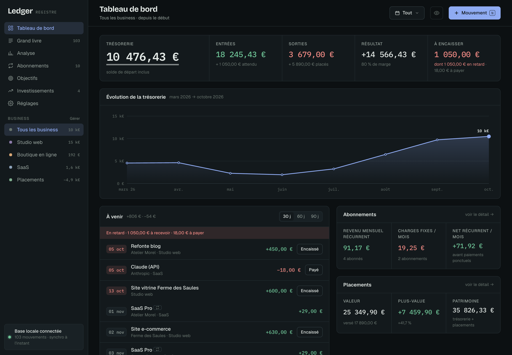
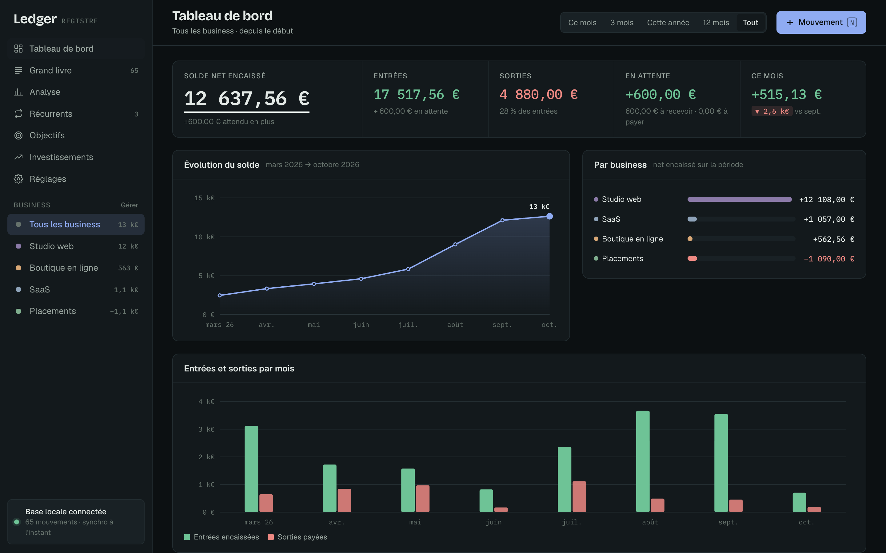
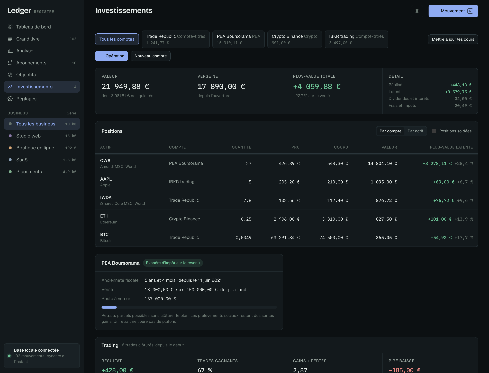
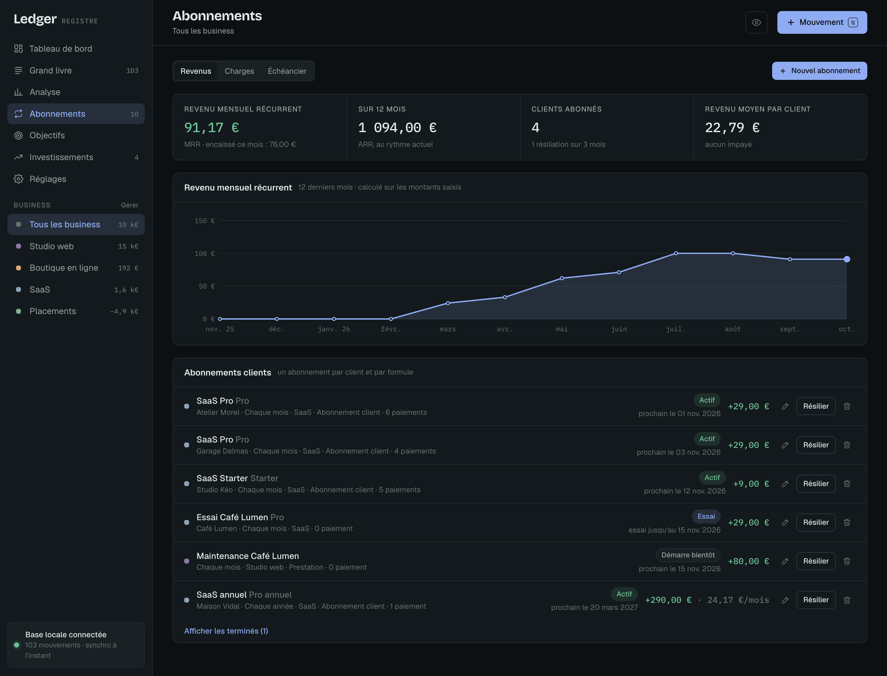

# Ledger

Ledger sert à suivre l'argent de plusieurs petits business au même endroit : ce qui rentre, ce qui sort, ce qu'on attend encore, les abonnements et les placements.

Tout reste chez toi. Les données sont dans une base SQLite sur ton ordinateur ou ton téléphone : pas de compte, pas de cloud, pas de pistage. Ledger tourne sur Mac, Windows, Android et iPhone.



<details>
<summary>Plus de captures</summary>




</details>

> Les captures utilisent des données fictives ([demo/ledger-demo.json](demo/ledger-demo.json)).

## Ce qu'on peut y faire

- **Suivre la trésorerie** de chaque business : entrées, sorties, résultat, ce qui reste à encaisser, et ce qui arrive bientôt (retards, échéances, prélèvements).
- **Saisir des paiements** uniques, récurrents ou en plusieurs fois (un acompte puis le solde, par exemple). Les échéances futures restent « en attente » jusqu'à ce qu'elles soient payées.
- **Suivre les abonnements**, dans les deux sens : le revenu récurrent d'un SaaS (MRR, résiliations, essais gratuits) et tes propres charges fixes.
- **Gérer des placements** : PEA, compte-titres, crypto. Prix de revient, plus-values, plafond et ancienneté du PEA, et un journal de trading avec ses statistiques.
- **Se fixer des objectifs** et voir le rythme mensuel à tenir.
- **Analyser** : meilleurs clients, principaux fournisseurs, rentabilité par business.

Quelques détails pratiques : thème clair ou sombre, un mode discret (touche `H`) qui masque les montants quand tu partages ton écran, des sauvegardes automatiques chaque jour, et l'export en JSON ou CSV. Tout est en euros.

## Installer

Tout se télécharge sur la page [Releases](../../releases/latest).

### Mac

Télécharge `Ledger-…-macOS-arm64.zip` (ou `x64` pour un Mac Intel), dézippe et glisse **Ledger.app** dans Applications.

L'app n'est pas signée par Apple, donc macOS la bloque au premier lancement. Va dans **Réglages Système → Confidentialité et sécurité** et clique sur **Ouvrir quand même**. Si macOS dit qu'elle « est endommagée », c'est le même blocage :

```bash
xattr -dr com.apple.quarantine /Applications/Ledger.app
```

### Windows

Télécharge `Ledger-…-Windows-x64.zip`, fais clic droit → **Extraire tout**, puis lance **Ledger.exe**. Si Windows affiche « Windows a protégé votre ordinateur », clique sur **Informations complémentaires** puis **Exécuter quand même**.

### Android

Télécharge `Ledger-….apk` sur le téléphone et ouvre-le. Android te demandera d'autoriser l'installation depuis cette source.

### iPhone

L'app n'est pas sur l'App Store : elle s'installe avec [Sideloadly](https://sideloadly.io) ou [AltStore](https://altstore.io), qui la signent avec ton identifiant Apple.

1. Télécharge `Ledger-…-iOS.ipa` sur ton Mac ou ton PC.
2. Branche l'iPhone, ouvre Sideloadly, glisse l'ipa dedans et connecte-toi avec ton identifiant Apple.
3. Sur l'iPhone : **Réglages → Général → VPN et gestion de l'appareil**, fais confiance à ton identifiant. Active aussi le **mode développeur** si iOS le demande (Réglages → Confidentialité et sécurité).

Avec un identifiant Apple gratuit, la signature expire au bout de 7 jours : il suffit de réinstaller par-dessus (AltStore le fait tout seul), les données restent.

## Synchroniser le téléphone et le Mac

Le téléphone garde sa propre base et marche hors connexion. Quand il est sur le même Wi-Fi que le Mac, les deux s'échangent leurs changements directement, chiffrés avec un code de jumelage. Aucun serveur entre les deux.

1. Sur le Mac : **Réglages → Synchronisation → Cet appareil est l'hôte**. Un code s'affiche.
2. Le coupe-feu de macOS peut bloquer la connexion. Si c'est le cas, autorise Node :
   ```bash
   sudo /usr/libexec/ApplicationFirewall/socketfilterfw --add "$(readlink -f "$(command -v node)")" --unblockapp "$(readlink -f "$(command -v node)")"
   ```
3. Sur le téléphone : **Réglages → Synchronisation → Rejoindre un appareil**, et saisis le code. Le Mac est trouvé tout seul. Sur iPhone, accepte l'accès au réseau local quand iOS le demande.

Ensuite tout se fait seul, à l'ouverture de l'app puis toutes les 30 secondes. Si une même ligne a changé des deux côtés, c'est la modification la plus récente qui gagne. Le Mac doit avoir Ledger ouvert (ou tourner en service avec `./install.sh`).

## Tes données

- Mac : `~/Library/Application Support/Ledger/`
- Windows : `%APPDATA%\Ledger\`
- Android et iPhone : dans l'app elle-même. Elles ne partent pas dans la sauvegarde Google ou iCloud ; c'est la synchro avec le Mac qui sert de copie.

On y trouve la base (`ledger.db`) et les 30 dernières sauvegardes. Supprimer l'app ne supprime pas les données sur ordinateur. Pour changer de machine, exporte en JSON et importe sur l'autre.

## Développer

Il faut Node.js 22.13 ou plus récent. Le serveur n'a aucune dépendance npm : il utilise le SQLite intégré à Node.

```bash
npm start          # http://localhost:4747 avec ta vraie base
npm run demo       # http://localhost:4799 avec les données fictives
npm test
```

`LEDGER_DATA_DIR` permet de travailler sur une autre base.

Pour construire les apps :

```bash
npm run build:mac        # Ledger.app (outils Xcode en ligne de commande)
npm run build:windows    # lanceur Go + Node pour Windows (il faut Go)
npm run build:android    # APK (il faut Android Studio, pas besoin de Gradle)
npm run build:ios        # ipa non signée (il faut Xcode)
```

Sur Mac et Windows, l'app démarre un petit serveur local (`server.mjs`) et affiche l'interface dans une fenêtre. Sur Android et iPhone, il n'y a pas de Node : le même moteur tourne directement dans une WebView, avec SQLite compilé en WebAssembly. Le code est rangé ainsi :

```
server/     moteur : base, calculs, API, synchro
public/     interface (HTML, CSS, JS sans framework)
mac/        app macOS (Swift)
windows/    lanceur Windows (Go)
android/    app Android (Java) et assemblage du moteur pour mobile
ios/        app iPhone (Swift)
```

`./install.sh` installe aussi Ledger comme service de fond sur Mac, accessible dans le navigateur. Ne l'utilise pas en même temps que Ledger.app.

## Licence

MIT
