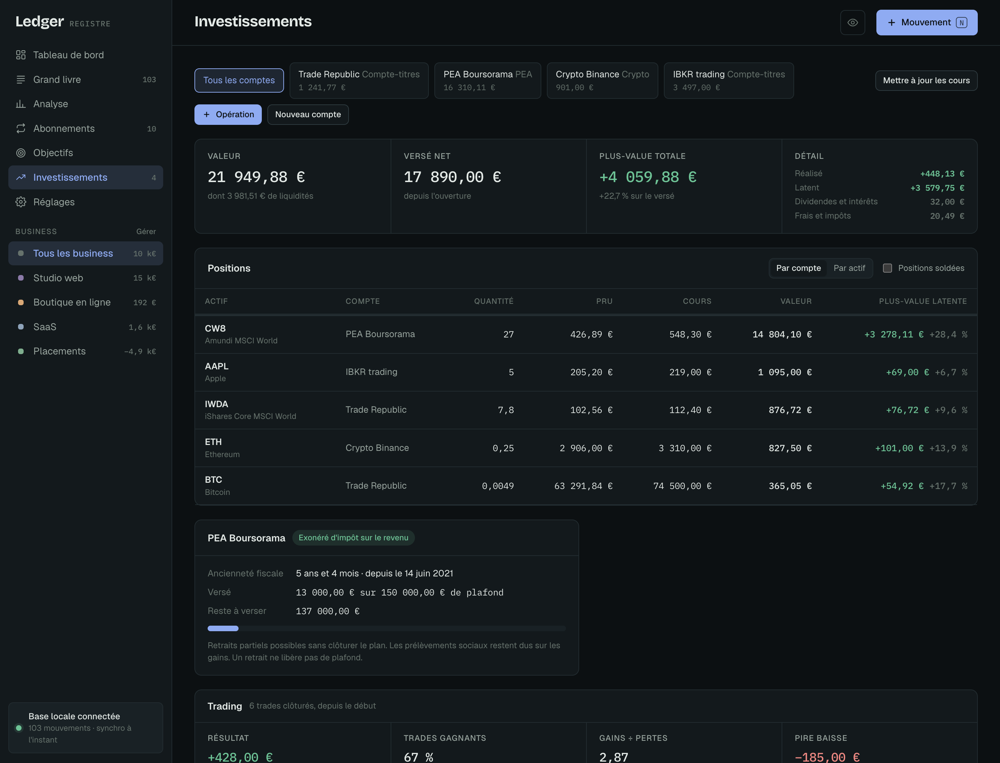
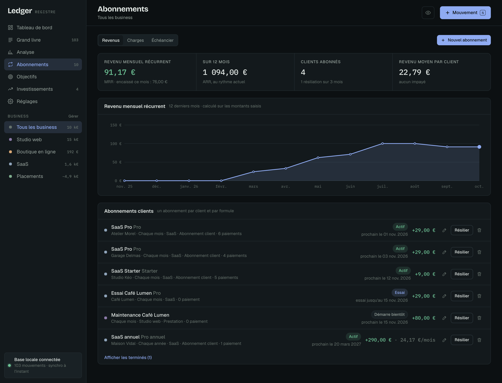

# Ledger

Un registre pour suivre l'argent de plusieurs petits business au même endroit : entrées, sorties, paiements en attente, abonnements, objectifs et placements.

Ledger est une app pour Mac et Windows qui fonctionne entièrement en local. Les données sont enregistrées dans une base SQLite sur ton ordinateur. Il n'y a ni compte, ni cloud, ni pistage.


<details>
<summary>Thème clair</summary>


</details>

> Les captures montrent des données fictives ([demo/ledger-demo.json](demo/ledger-demo.json)).

## Ce que fait Ledger

### Trésorerie
- **Tableau de bord** : trésorerie (avec un solde de départ par business), entrées, sorties, résultat et ce qui reste à encaisser, comparés à la période précédente. Encarts « À venir » (retards, échéances, prochains prélèvements), abonnements, placements et patrimoine. Tu choisis les encarts affichés.
- **Paiements uniques, récurrents ou en plusieurs fois** : un mouvement peut être payé une fois, se répéter (chaque semaine, mois, trimestre, année…) ou être découpé en échéances, avec des dates et des montants modifiables (ex. acompte de 30 % puis solde). Les échéances futures restent « en attente » jusqu'à leur encaissement.
- **Grand livre** : mouvements groupés par mois, solde de trésorerie ligne par ligne, mouvements futurs à part, filtres (nature, statut, retard, catégorie), recherche par libellé ou client, colonnes au choix.
- **Remboursements** : un remboursement client réduit le chiffre d'affaires, un remboursement fournisseur réduit les dépenses.
- **Plusieurs business**, clients et fournisseurs, catégories, archivage sans perte d'historique.

### Abonnements
- **Revenus récurrents (SaaS, contrats mensuels)** : revenu mensuel récurrent (MRR), revenu sur 12 mois (ARR), nombre d'abonnés, revenu moyen par client, courbe du MRR avec nouveaux abonnés, résiliations et changements de prix. Essais gratuits, fin après un nombre de paiements, résiliation et réactivation.
- **Charges fixes** : coût mensuel et annuel de tes abonnements, prochains prélèvements, répartition par catégorie, montants variables (facturation à l'usage) à confirmer au paiement.
- **Échéancier** : tout ce qui est attendu sur 12 mois.
- Les paiements sont créés automatiquement à chaque échéance.

### Investissements
- **Comptes** : PEA, PEA-PME, compte-titres, crypto, autre. Un compte existant se reprend avec ses positions actuelles, sans ressaisir l'historique.
- **Opérations** : achat, vente, versement, retrait, dividende (brut et retenues), intérêts, frais, impôt, division d'actions, et « trade clôturé » pour le CFD, les futures ou les options. Les versements et retraits sont reliés à la trésorerie d'un business, ou à « Perso ».
- **Positions** au prix de revient unitaire (PRU, frais inclus), plus-values latentes et réalisées, par compte ou regroupées par actif, cours à mettre à jour en un écran.
- **PEA** : ancienneté depuis le premier versement, date des 5 ans, plafond de versements (150 000 €, 20 000 € pour un PEA jeune, 225 000 € pour un PEA-PME) et avertissement avant un retrait anticipé.
- **Trading** : résultat, part de trades gagnants, ratio gains/pertes, pire baisse, durée moyenne, résultat par mois et journal des trades.
- Une vente qui dépasse la quantité détenue, ou un achat sans liquidités sur un PEA, est refusé.

### Le reste
- **Objectifs** sur le résultat, le chiffre d'affaires, le revenu récurrent ou la valeur des placements, avec le rythme mensuel à tenir.
- **Analyse** : part des revenus récurrents, résultat par mois, rentabilité par business (placements compris), meilleurs clients, principaux fournisseurs, catégories.
- **Affichage** : thème clair ou sombre, centimes, densité, période et vue à l'ouverture, comparaison avec la période précédente, et **mode discret** (touche `H`) qui masque tous les montants, par exemple pour partager ton écran.
- **Sauvegardes** quotidiennes (les 30 dernières), plus une avant chaque import, restauration ou mise à jour, gardée à part. Restauration en un clic.
- **Export** JSON complet, CSV des mouvements et des opérations de placement, **import** JSON (y compris les exports de Ledger 1.0).
- Raccourcis : `N` nouveau mouvement, `/` rechercher, `H` mode discret, `⌘1` à `⌘7` pour changer de section.

<details>
<summary>Captures : investissements et abonnements</summary>



</details>

Tout est en euros : pour un actif coté en dollars, saisis les montants en euros de ton relevé.

## Installer l'app

### Mac

1. Télécharge `Ledger-…-macOS-arm64.zip` (Mac Apple Silicon) ou `…-x64.zip` (Mac Intel) depuis la page [Releases](../../releases/latest).
2. Dézippe et glisse **Ledger.app** dans **Applications**.
3. Au premier lancement, macOS bloque l'app parce qu'elle n'est pas signée par un développeur Apple enregistré. Ouvre **Réglages Système → Confidentialité et sécurité**, puis clique sur **Ouvrir quand même** en bas de la page.

Si macOS dit que l'app « est endommagée », c'est le même blocage. Retire-le avec cette commande dans le Terminal :

```bash
xattr -dr com.apple.quarantine /Applications/Ledger.app
```

macOS 12 ou plus récent (macOS 13 pour la version Intel). Rien d'autre à installer : l'app embarque son propre moteur (Node.js).

### Windows

1. Télécharge `Ledger-…-Windows-x64.zip` depuis la page [Releases](../../releases/latest).
2. Fais clic droit sur le zip, choisis **Extraire tout**, puis place le dossier `Ledger` où tu veux (par exemple dans Documents).
3. Double-clique sur **Ledger.exe**. Si Windows affiche « Windows a protégé votre ordinateur », clique sur **Informations complémentaires** puis **Exécuter quand même**.
4. Pour le retrouver facilement, fais clic droit sur `Ledger.exe` puis **Épingler au menu Démarrer**.

Windows 10 ou 11. L'interface s'ouvre dans une fenêtre d'application Microsoft Edge (sans onglets ni barre d'adresse). Edge est déjà installé sur tous les Windows récents.

### Téléphone

Il n'y a pas encore de version téléphone. L'interface s'adapte aux petits écrans, mais le serveur tourne sur l'ordinateur et n'accepte que les connexions venant de celui-ci, donc un téléphone ne peut pas y accéder.

## Où sont mes données

| Système | Dossier |
| --- | --- |
| Mac | `~/Library/Application Support/Ledger/` |
| Windows | `%APPDATA%\Ledger\` |
| Linux (depuis les sources) | `~/.local/share/ledger/` |

Le dossier contient :

| Fichier | Contenu |
| --- | --- |
| `ledger.db` | la base SQLite |
| `backups/` | les sauvegardes quotidiennes |
| `logs/` | le journal du serveur local |

Sur Mac, le menu **Fichier → Afficher le dossier des données** l'ouvre dans le Finder. Le bouton de **Réglages → Base de données** fonctionne sur les deux systèmes. Pour changer d'ordinateur, y compris passer d'un Mac à un PC, exporte en JSON puis importe sur l'autre machine. Supprimer l'app ne supprime pas les données.

## Comment ça marche

```
Ledger.app
├── Contents/MacOS/Ledger          fenêtre native (Swift + WebKit)
└── Contents/Resources
    ├── runtime/node               Node.js officiel, signé par la fondation Node.js
    └── app/server.mjs + public/   serveur local + interface
```

Au lancement, l'app démarre `server.mjs` sur `127.0.0.1:4747`, accessible depuis ce Mac uniquement, puis affiche l'interface. Le serveur utilise le module `node:sqlite` intégré à Node, il n'a donc aucune dépendance npm. Il s'arrête quand tu quittes l'app.

Sous Windows, `Ledger.exe` est un petit lanceur écrit en Go. Il démarre le même serveur avec le Node.js officiel pour Windows, puis ouvre la fenêtre Edge. Le serveur s'arrête tout seul 5 minutes après la fermeture de la dernière fenêtre.

Tant que l'app est ouverte, l'interface est aussi disponible dans ton navigateur sur [http://localhost:4747](http://localhost:4747). Le serveur refuse les requêtes envoyées par d'autres sites web, qui ne peuvent donc pas modifier tes données en visant ce port.

## Développer

Il faut Node.js 22.13 ou plus récent.

```bash
npm start              # serveur sur http://localhost:4747 avec ta vraie base
npm test               # tests (calculs et API sur une base temporaire)
npm run demo           # serveur de démo sur http://localhost:4799 (données fictives, base séparée)
```

La variable `LEDGER_DATA_DIR` change le dossier des données. Exemple pour travailler sur une base de test :

```bash
LEDGER_DATA_DIR=./build/test node server.mjs --port 4799
```

Pour construire l'app, il faut les outils en ligne de commande de Xcode (`xcode-select --install`) :

```bash
npm run build:mac              # dist/arm64/Ledger.app et le zip
ARCH=x64 npm run build:mac     # version Mac Intel
```

Le script télécharge le binaire officiel de Node.js et vérifie sa somme de contrôle, dessine l'icône, compile l'app Swift et la signe en ad hoc.

La version Windows se construit depuis un Mac ou Linux. Il faut Go (`brew install go`) :

```bash
npm run build:windows          # dist/windows/Ledger/ et le zip
```

Sans l'app, `./install.sh` installe Ledger comme service de fond accessible dans le navigateur, et `./uninstall.sh` le retire. N'utilise pas les deux en même temps.

## Structure

```
server.mjs            serveur HTTP et routes de l'API
server/               base SQLite, migrations, trésorerie, abonnements, placements, import/export, sauvegardes
public/               interface (HTML, CSS et modules JS sans framework)
public/js/dates.js    calcul des échéances, partagé par le serveur et l'interface
public/js/lib/        moteurs de calcul partagés : portefeuille (PRU, trades, PEA), abonnements (MRR, à venir)
test/                 tests (node --test) : échéances, portefeuille, abonnements, API de bout en bout
mac/LedgerApp.swift   app macOS
mac/build.sh          construction de Ledger.app
mac/make-icon.swift   icône
windows/main.go       lanceur Windows (Go)
windows/build.sh      construction de la version Windows
demo/                 données fictives
```

## Licence

MIT
