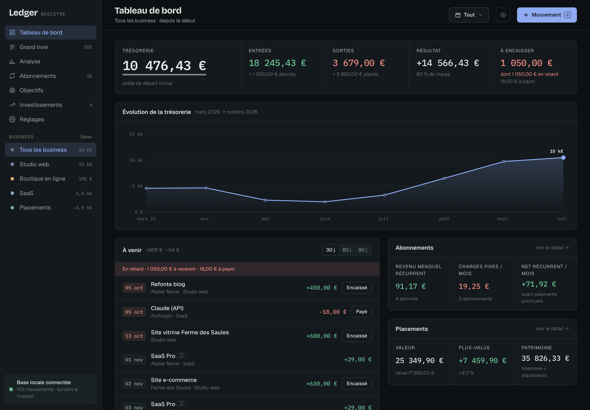
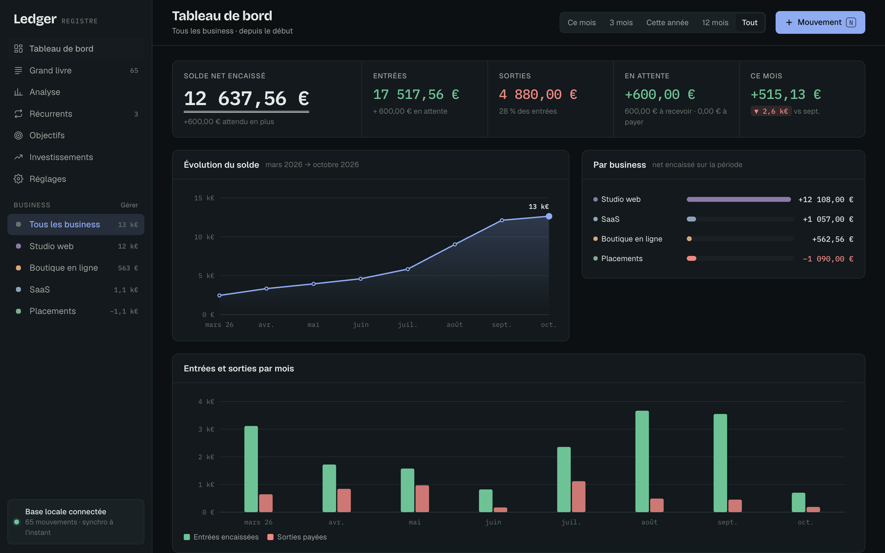

# Ledger

Un registre pour suivre l'argent de plusieurs petits business au même endroit : entrées, sorties, paiements en attente, abonnements, objectifs et placements.

Ledger est une app pour Mac et Windows qui fonctionne entièrement en local. Les données sont enregistrées dans une base SQLite sur ton ordinateur. Il n'y a ni compte, ni cloud, ni pistage.



<details>
<summary>Thème clair</summary>


</details>

> Les captures montrent des données fictives ([demo/ledger-demo.json](demo/ledger-demo.json)).

## Ce que fait Ledger

- **Tableau de bord** : solde encaissé, entrées, sorties, montants en attente, évolution du solde, résultat par business.
- **Grand livre** : tous les mouvements regroupés par mois, avec le solde cumulé ligne par ligne, des filtres, une recherche et le tri par colonne. Un clic sur le statut le fait passer de « En attente » à « Payé ».
- **Plusieurs business** : chaque mouvement est rattaché à un business. Tu peux tout voir ensemble ou un business à la fois, et archiver un business sans perdre son historique.
- **Récurrents** : abonnements, loyers, clients mensuels. Le mouvement est créé automatiquement à chaque échéance.
- **Objectifs** : progression basée sur ce qui est encaissé, montant à faire par mois pour tenir l'échéance.
- **Analyse** : marge, CA moyen, meilleur mois, rentabilité par business, répartition par catégorie.
- **Investissements** : positions, prix de revient moyen, plus-values latentes et réalisées.
- **Sauvegardes** : une copie de la base chaque jour (les 30 dernières sont gardées), et une avant chaque import ou restauration. On restaure en un clic depuis Réglages.
- **Export** JSON et CSV (le CSV s'ouvre directement dans Excel ou Numbers), **import** JSON.
- Thème clair et sombre, raccourcis clavier (`N` pour un nouveau mouvement, `/` pour rechercher, `⌘1` à `⌘7` pour changer de section).

## Installer l'app

### Mac

1. Télécharge `Ledger-…-macOS-arm64.zip` (Mac Apple Silicon) ou `…-x64.zip` (Mac Intel) depuis la page [Releases](../../releases/latest).
2. Dézippe et glisse **Ledger.app** dans **Applications**.
3. Au premier lancement, macOS bloque l'app parce qu'elle n'est pas signée par un développeur Apple enregistré. Ouvre **Réglages Système → Confidentialité et sécurité**, puis clique sur **Ouvrir quand même** en bas de la page.

Si macOS dit que l'app « est endommagée », c'est le même blocage. Retire-le avec cette commande dans le Terminal :

```bash
xattr -dr com.apple.quarantine /Applications/Ledger.app
```

macOS 12 ou plus récent (macOS 13 pour la version Intel). Rien d'autre à installer : l'app embarque son propre moteur (Node.js).

### Windows

1. Télécharge `Ledger-…-Windows-x64.zip` depuis la page [Releases](../../releases/latest).
2. Fais clic droit sur le zip, choisis **Extraire tout**, puis place le dossier `Ledger` où tu veux (par exemple dans Documents).
3. Double-clique sur **Ledger.exe**. Si Windows affiche « Windows a protégé votre ordinateur », clique sur **Informations complémentaires** puis **Exécuter quand même**.
4. Pour le retrouver facilement, fais clic droit sur `Ledger.exe` puis **Épingler au menu Démarrer**.

Windows 10 ou 11. L'interface s'ouvre dans une fenêtre d'application Microsoft Edge (sans onglets ni barre d'adresse). Edge est déjà installé sur tous les Windows récents.

### Téléphone

Il n'y a pas encore de version téléphone. L'interface s'adapte aux petits écrans, mais le serveur tourne sur l'ordinateur et n'accepte que les connexions venant de celui-ci, donc un téléphone ne peut pas y accéder.

## Où sont mes données

| Système | Dossier |
| --- | --- |
| Mac | `~/Library/Application Support/Ledger/` |
| Windows | `%APPDATA%\Ledger\` |
| Linux (depuis les sources) | `~/.local/share/ledger/` |

Le dossier contient :

| Fichier | Contenu |
| --- | --- |
| `ledger.db` | la base SQLite |
| `backups/` | les sauvegardes quotidiennes |
| `logs/` | le journal du serveur local |

Sur Mac, le menu **Fichier → Afficher le dossier des données** l'ouvre dans le Finder. Le bouton de **Réglages → Base de données** fonctionne sur les deux systèmes. Pour changer d'ordinateur, y compris passer d'un Mac à un PC, exporte en JSON puis importe sur l'autre machine. Supprimer l'app ne supprime pas les données.

## Comment ça marche

```
Ledger.app
├── Contents/MacOS/Ledger          fenêtre native (Swift + WebKit)
└── Contents/Resources
    ├── runtime/node               Node.js officiel, signé par la fondation Node.js
    └── app/server.mjs + public/   serveur local + interface
```

Au lancement, l'app démarre `server.mjs` sur `127.0.0.1:4747`, accessible depuis ce Mac uniquement, puis affiche l'interface. Le serveur utilise le module `node:sqlite` intégré à Node, il n'a donc aucune dépendance npm. Il s'arrête quand tu quittes l'app.

Sous Windows, `Ledger.exe` est un petit lanceur écrit en Go. Il démarre le même serveur avec le Node.js officiel pour Windows, puis ouvre la fenêtre Edge. Le serveur s'arrête tout seul 5 minutes après la fermeture de la dernière fenêtre.

Tant que l'app est ouverte, l'interface est aussi disponible dans ton navigateur sur [http://localhost:4747](http://localhost:4747). Le serveur refuse les requêtes envoyées par d'autres sites web, qui ne peuvent donc pas modifier tes données en visant ce port.

## Développer

Il faut Node.js 22.13 ou plus récent.

```bash
npm start              # serveur sur http://localhost:4747 avec ta vraie base
npm run demo           # serveur de démo sur http://localhost:4799 (données fictives, base séparée)
```

La variable `LEDGER_DATA_DIR` change le dossier des données. Exemple pour travailler sur une base de test :

```bash
LEDGER_DATA_DIR=./build/test node server.mjs --port 4799
```

Pour construire l'app, il faut les outils en ligne de commande de Xcode (`xcode-select --install`) :

```bash
npm run build:mac              # dist/arm64/Ledger.app et le zip
ARCH=x64 npm run build:mac     # version Mac Intel
```

Le script télécharge le binaire officiel de Node.js et vérifie sa somme de contrôle, dessine l'icône, compile l'app Swift et la signe en ad hoc.

La version Windows se construit depuis un Mac ou Linux. Il faut Go (`brew install go`) :

```bash
npm run build:windows          # dist/windows/Ledger/ et le zip
```

Sans l'app, `./install.sh` installe Ledger comme service de fond accessible dans le navigateur, et `./uninstall.sh` le retire. N'utilise pas les deux en même temps.

## Structure

```
server.mjs            API REST + SQLite + sauvegardes + récurrences
public/index.html     interface (HTML, CSS et JS sans framework)
mac/LedgerApp.swift   app macOS
mac/build.sh          construction de Ledger.app
mac/make-icon.swift   icône
windows/main.go       lanceur Windows (Go)
windows/build.sh      construction de la version Windows
demo/                 données fictives
```

## Licence

MIT
